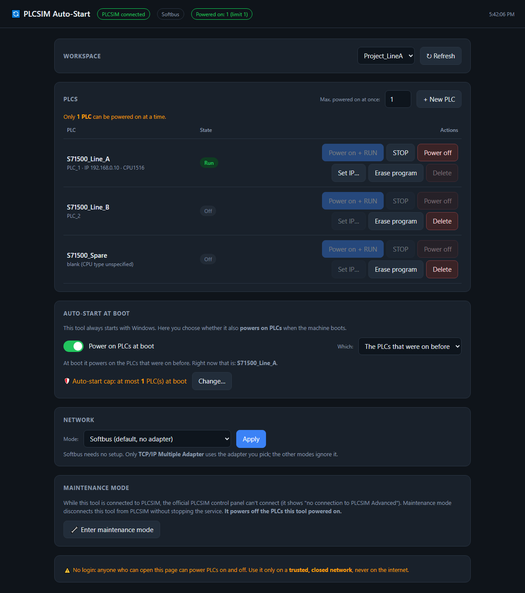

# PLCSIM Auto-Start

**Powers on your Siemens S7-PLCSIM Advanced PLCs automatically at boot, and lets you control them from a
browser.**

PLCSIM Auto-Start is a small web app that runs all the time next to S7-PLCSIM Advanced. It doesn't replace
PLCSIM: it works on the same workspace as the Siemens PLCSIM GUI and adds three things:

- 🔄 **Auto-start at boot.** After the machine restarts, the PLCs that were on come back on by themselves,
  with nobody there (this needs auto-logon, which the installer offers). Read
  [Capacity](#capacity-how-many-plcs-this-machine-can-run) before you turn it on.
- 🌐 **Control from a browser.** Power on, RUN, STOP and power off your PLCs from any machine on the
  network, without Remote Desktop.
- 💾 **Programs survive a restart.** Each PLC keeps the program you downloaded from TIA Portal, so after a
  reboot there is nothing to download again.

> Independent, open-source tool, **not** affiliated with Siemens. It uses the Siemens PLCSIM Advanced API,
> which you install separately under your own Siemens license. The Siemens DLL is **not** included here;
> the tool finds the one already installed on your machine.

---

## Other features

- **Power-on limit:** the most PLCs the page lets you power on at once (default **1**).
- **Fixed IP per PLC:** set from the page, and set again every time the PLC is powered on.
- **Network mode:** Softbus (no setup) or TCP/IP through a network adapter of the machine.
- **New PLC and Delete:** create a blank PLC in the workspace, or delete a powered-off one. Deleting
  deletes its program, with no backup.
- **Erase program:** erases a PLC's program and hardware configuration so TIA Portal can download a project
  with a different CPU.
- **Maintenance mode:** disconnects this tool from PLCSIM without stopping the service, so the official
  PLCSIM control panel can connect. It powers off the PLCs this tool powered on.
- **Runs as a Windows Service** that you start and stop from `services.msc`. PLCSIM needs a signed-in user,
  so the service starts the app in the session of the user signed in at the machine's console. See
  [docs/INSTALL.md](docs/INSTALL.md#how-the-service-works).

---

## Requirements

- **Windows 10 / Windows Server 2016 or newer** (x64).
- **Siemens S7-PLCSIM Advanced** (tested with **V20**). It provides the runtime and the API DLL.
- **.NET Framework 4.x**, which is already part of Windows. No Visual Studio or .NET SDK needed.
- **A user signed in to Windows** at the machine's console. PLCSIM needs it for networking. For a machine
  that must recover by itself after a reboot, turn on auto-logon (the installer offers it; see
  [docs/INSTALL.md](docs/INSTALL.md)).

---

## Quick start (no programming needed)

1. **Download** the project: green **Code** button → **Download ZIP**. You get
   **`PLCSIM-AutoStart-main.zip`**, with the ready-to-run `PlcsimAutoStart.exe` inside. Extract it anywhere.
2. **Double-click `Install.cmd`** and accept the administrator prompt (UAC). It:
   - finds your PLCSIM Advanced installation,
   - makes the page reachable from the network (no login; it opens the port in the firewall),
   - creates `appconfig.txt`,
   - installs the **Windows Service "PLCSIM AutoStart"**,
   - offers to turn on **auto-logon** for unattended boot.

   *(From an elevated PowerShell you can run `scripts\install.ps1` instead. Add `-LocalOnly` to make the
   page reachable only from this machine.)*
3. Open the page:
   - on this machine: **http://localhost:8090**
   - from another machine: **http://&lt;this-machine-ip&gt;:8090**

To remove it later, run `.\scripts\uninstall.ps1` as administrator.

---

## For developers

The ready-to-run `PlcsimAutoStart.exe` is in the repo. After you change `src\PlcsimAutoStart.cs`, rebuild
it with `.\scripts\build.ps1`. The build uses the C# compiler that comes with the .NET Framework; no IDE
needed.

---

## Capacity: how many PLCs this machine can run

Each running PLC uses real CPU and memory. On a 2-vCPU Azure VM, one running PLC (a CPU 1517F) used a full
CPU core and about 960 MB of memory. With a second PLC powered on, the whole machine froze. The page barely
responded, but powering the second PLC off from it worked, and the machine recovered.

Two settings limit how many PLCs are on:

| Setting | On the page | What it limits |
|---|---|---|
| `max_powered_on` | **Max. powered on at once** (PLCs card) | The page buttons. When that many PLCs are on, the page doesn't let you power on another. |
| `hard_max_powered_on` | **Auto-start cap** (Auto-start card) | Auto-start at boot. It doesn't power on more PLCs than this. |

Both are **1** by default. The page limit can be set higher than the auto-start cap, but only raise it if
the machine can run that many PLCs at once.

**Why the auto-start cap matters.** If auto-start powers on more PLCs than the machine can run, the machine
can freeze during boot. Auto-start runs on every boot, so it would freeze again after each restart. Set the
cap to the number of PLCs the machine can really run.

**The loop-breaker.** After auto-start, the tool checks for a while (90 s by default) that PLCSIM and its
own web page keep answering. If several boots in a row (2 by default) fail that check, the next boot skips
auto-start and the page shows a red **SAFE MODE** banner. Lower the auto-start cap, then click
**Re-enable auto-start**.

All settings are explained in [docs/CONFIGURATION.md](docs/CONFIGURATION.md).

---

## Documentation

- [docs/INSTALL.md](docs/INSTALL.md): install, auto-logon, network access.
- [docs/CONFIGURATION.md](docs/CONFIGURATION.md): every `appconfig.txt` setting.
- [docs/TROUBLESHOOTING.md](docs/TROUBLESHOOTING.md): common problems and what to do.

## License

[MIT](LICENSE) © 2026 Marcelo Tapia. Not affiliated with Siemens.
